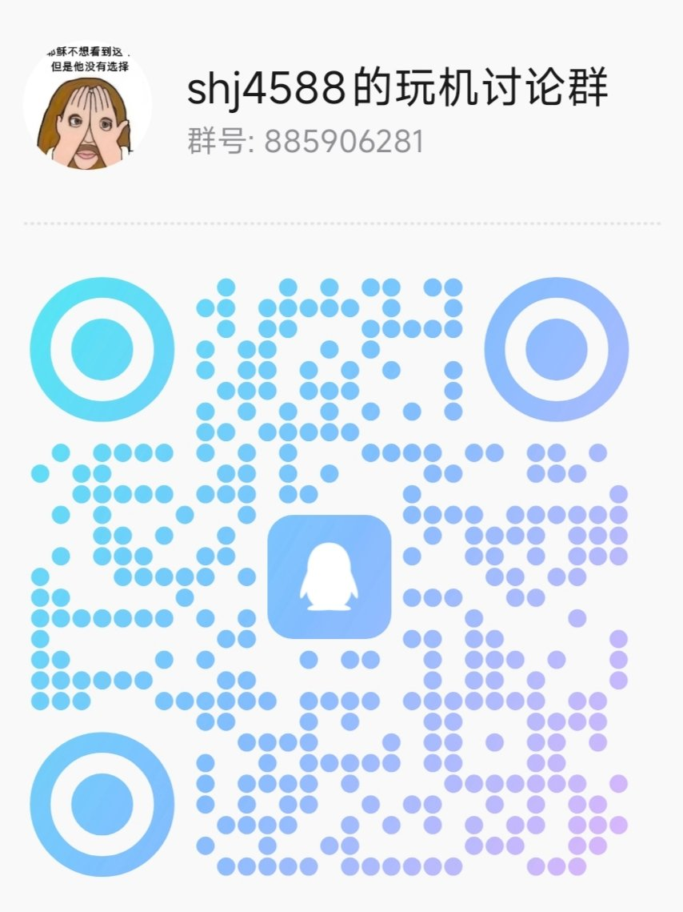

# LDY-B5 小智客户端

**V1.0.1 正式版** · 项目地址：<https://github.com/shj4588/LDY-B5_XiaoZhi_Client>

给 **中国移动「和家小荷」LDY-B5 带屏智能音箱**（携住酒店定制 flavor，MT8167 / Android 8.1.0 / API 27）用的「小智」语音客户端，包名 `cn.workbuddy.ldyb5app`。在原厂云知声四麦硬件通路上实现本地唤醒、WebSocket 语音对话、TTS 播放，并通过 MCP 让小智控制设备上的音乐、电视直播、屏幕与系统设置。

---

## 一、安装与版本说明

- 安装包：`LDY-B5_XiaoZhi_Client_V1.0.1.apk`（`versionName=V1.0.1`，`versionCode=63`）。
- 系统要求：APK `minSdk=21` / `targetSdk=22`、`armeabi-v7a` 32 位；**实测开发设备为 LDY-B5（MT8167 / Android 8.1.0 / API 27）**。原厂四麦 HAL、MTK 背光节点、桌面与系统设置均按该机适配，其它设备不保证可用。
- 权限：`RECORD_AUDIO`、`INTERNET`、`SYSTEM_ALERT_WINDOW`（灵动岛悬浮窗）、`RECEIVE_BOOT_COMPLETED`（开机自启）等；**Root 不是必需**，但不开 Root 会失去部分功能，见第四章。

- **仿系统音量条**：固件本身砍掉了系统音量面板，本客户端在小智界面内/外按音量键都会弹出左侧仿系统音量竖条（含静音红斜杠），约 1.5s 后淡出。要让「已经是静音再按减键」也弹条，需在系统「设置 → 无障碍」里开启本应用的「小智音量条」服务；未开启时退回广播方案，仅音量真正变化时才弹条。
- 首次启动后在小智设置里可改唤醒词、灵敏度、服务器地址；设置页标题右侧显示当前 APK 的版本号，页面底部是项目地址（可点击打开）。

### 适用设备

本机是 **LDY-B5 带屏智能音箱**：中国移动「和家小荷」渠道型号（商城名「和家小荷音箱 7英寸大屏幕视频通话智能控制 LDY-B5」，¥599），本机刷的是 **携住科技酒店客房定制固件**（原厂 Launcher 版本 `v6.9.0.4-xiezhuCM`，含客控/心跳/酒店业务）。

| 项 | 实测值（`getprop` / `pm` / `/proc`） |
|---|---|
| 产品标识 | `brand=Pandora`、`model=A2-CM`、`device=t6770_l37rme_32`、`manufacturer=emdoor` |
| 主控 | MediaTek **MT8167**（4×Cortex-A35），`armeabi-v7a` 32 位 |
| 系统 | **Android 8.1.0 / API 27**，固件 2020-02-24，安全补丁 2019-08-05，`getenforce=Permissive` |
| 内存 / 存储 | ≈1 GB RAM、8 GB eMMC（`/data` 4.8 G）、`low_ram=true` |
| 屏幕 | 7 英寸，物理 600×1024（`hwrotation=270` → 横屏 1024×600），density 160 |
| 音频 | 云知声 Uni4mic 四麦 HAL（`libUni4micHalJNI.so` 等），ALSA `mt-snd-card` |
| 原厂语音 | `com.unisound.aios.pandora.clock` + `com.cmcc.jarvis.tcplib`（中国移动 Jarvis 云） |
| 背光 | MTK `/sys/class/leds/lcd-backlight` |

### 双轨版本号

本项目有两条版本线，**共用同一份代码、同一个 `versionCode`**，只是 `versionName` 不同：

| 版本线 | versionName | 用途 |
|---|---|---|
| 内测版 | `0.3.x-ldyb5`（保持 `0.` 开头） | 主线日常迭代，设备上的开发版 |
| 正式版 | `V1.0.x` | 对外发布，即本目录里的 APK |

两者 `versionCode` 相同（本版为 63），因此可以**直接互相覆盖安装**，不会出现「正式版 versionCode 更高、内测版装不回去」的降级问题。设置页显示的是 APK 自身的真实 `versionName`，不会写死在代码里。

构建方式（项目根目录）：

```bash
bash build-win.sh v0.3.59-ldyb5          # 内测版：直接用 AndroidManifest.xml 的 0.x
bash build-win.sh V1.0.1 V1.0.1         # 正式版：第 2 个参数覆盖 versionName
bash build-win.sh V1.0.1 V1.0.1 101     # 第 3 个参数可另指定 versionCode
```

正式版构建时脚本会复制一份 manifest 只替换版本号，**主线源码里的内测版本号不受影响**。

---

## 二、四麦拾音与降噪是怎么实现的

### 2.1 先说结论

硬件是 4 麦阵列，但**波束成形、降噪、AGC、回声抑制主要由原厂音频 HAL 完成**，Java 层没有自研波束/DOA，也没有引入 WebRTC NS、Speex、RNNoise 之类的第三方降噪库。客户端做的是：把 HAL 的输出稳定取出来、下混成单声道、按时序送给唤醒引擎和 opus 编码器，并用一整套**软件状态机防止「自己说话被自己听见」**。

HAL 内部算法在 `.so` 里（未反编译），本文只描述 Java 层可见的接口与行为。本机 `/system/lib` 可见 `libUni4micHalJNI.so`、`libUniMicArray.so`、`libUniLinearMicArray.so`、`libuni4michal.so` 等，ALSA 声卡是 MTK 的 `mt-snd-card`；**DSP 芯片型号未拆机核实**。

### 2.2 音频通路与三种音源

| 音源 | 打开方式 | 说明 |
|---|---|---|
| 默认 `AudioRecord` | `MediaRecorder.AudioSource.VOICE_COMMUNICATION` | 这个 source 决定原厂 HAL 是否把 ADC 接到真实麦阵并启用语音通话用例的回声抑制；可用 `files/src_vrec` 切到 `VOICE_RECOGNITION` |
| 原厂四麦 HAL 直连 | `Uni4micHalJNI`（`files/src_uni4mic`） | 加载 `/system/lib` 的 `libUni4micHalJNI.so` 等，`openAudioIn(2)` → `startRecorder()` → 循环 `readData()`；`close4MicAlgorithm(0)` 表示**保留** HAL 算法。拿到的是与原厂完全相同的四麦波束/降噪输出 |
| MicBridge | TCP `127.0.0.1:5013`（`files/src_bridge`） | 从 player 进程里注入的 Cap4mic 服务端取流。一般 APK 是 `untrusted_app` 域、摸不到 `/dev/snd`，且 SELinux 会拦 abstract LocalSocket，所以改用 TCP 环回（本机实测 `getenforce=Permissive`，无 SELinux 拦截） |

**关键数值**（`AudioCapture.java`）：

- 采样率 16 kHz、单声道、PCM16；每帧 60 ms = 960 samples = 1920 B，正好对应 opus 帧长。
- 物理 4 麦，但 HAL 实际输出 **2 声道**（`RAW_CHANNELS=2`，`64000 B/s = 16k×2ch×2B`），`downmix()` 默认取 `(L+R)>>1`，`files/hal_ch0` 可改为只取第 0 声道。**没有自研波束成形**。
- `AudioRecord` 缓冲区固定 `4096×4 = 16384 B`，刻意不调用 `getMinBufferSize()`（mediaserver 卡死时这个同步 Binder 永不返回）。
- 读线程 `L5MicReader` 用 `Thread.MAX_PRIORITY`；播放线程设为 `THREAD_PRIORITY_URGENT_AUDIO`，避免被采集线程压制导致 TTS 卡顿。
- `uplinkGain=16` 是线性放大 + int16 饱和钳位；**等比放大不改变 SNR，救不了远场**，远场效果取决于 HAL。
- `sessionBind` 可在同一 audio session 上常驻一条写静音的 `AudioTrack`，逼 HAL 进入全双工语音用例。
- 环形预缓冲 `preroll=500 ms`，唤醒后把唤醒词之前的音频补发出去。

### 2.3 唤醒

`KwsEngine` 用 **sherpa-onnx `KeywordSpotter`**（zipformer2 int8，CPU，16 kHz / 80 维 fbank），模型与词表在 `assets/kws/`。默认阈值 `0.05`、关键词分数 `6.0`、8 条活跃路径、单线程（避免 ORT intra-op 线程池自旋）。设置页提供 5 档灵敏度（迟钝 / 偏低 / 标准 / 灵敏 / 很灵敏），保存后自动重启语音服务重建引擎并提示完成。

采集到的每一帧都无条件喂给 KWS（即使 TTS 播放中），因此支持「唤醒词打断」。KWS 内部另有一层**静音门控（VAD gate）**用于省 CPU，它不是 AEC；其中 `gateSustainFrames` 专门防止 TTS 回声把门长期焊死。此外 `WakeupBridge` 还能从原厂 msgcenter 总线接收「小讯小讯」唤醒事件。

### 2.4 回声 / 自问自答防护（自研软件链路）

设备没有可用的 AEC：系统 `AcousticEchoCanceler` 默认**关闭**（实测会把近端人声一起压掉）；服务端 AEC 由官方服务器自己跑，客户端 hello **不带** `features.aec`（带上会导致官方服务器对 hello 静默）。所以防自环靠 `SessionController` + `TtsPlayer` 的状态机：

1. **TTS 播放期上行全关**：`onTtsStart()` 置 `suppressUplink=true`，`onFrame()` 直接 return；barge-in 默认关闭（`files/bargein_on` 可开）。
2. **句尾静音续播**：`holdSilenceMs=4000 ms`，数据播完后继续按实时速率写数字静音，让播放流保持活跃 —— **HAL 只在存在活跃播放流时启用回声抑制**，如果立刻停流，下一句开头就会把自己的声音收进去。
3. **TTS 结束后落闸 + 延迟恢复**：`onTtsStop()` 装 `echoGate`，等 `TtsPlayer.isDrained()` 再放行上行（250~900 ms 轮询，带死锁强制恢复兜底）。
4. **电平闸门 echoGate**：`echoRms=8000`（介于真人声与 TTS 回声之间）、连续 8 帧（480 ms）低于阈值才开闸；最小强制压制 1200 ms 防「播放期假安静」骗开闸门，最长 4000 ms 强制放行。闸门内不上行，每 500 ms 打一次诊断日志。
5. **唤醒应答音不丢帧**：`wakeAckEchoDropMs=0`，早期设计的 320 ms 硬丢会把连读指令的第一个词剪掉，已废弃。
6. **唤醒词处理（两种模式）**：默认情况下本地 KWS 命中后即开流，唤醒词与后续指令作为正常音频一起上行（preroll 预缓冲补发），服务端直接听到；不发送 `listen/detect`，因此也不会出现服务端问候 TTS。设置页另有「唤醒词不上传」开关（默认关）：开启后本地**丢弃唤醒词缓冲、不发 detect**，云端只收到唤醒词之后的指令，因此**不会触发服务端「嘿你好呀」那句问候**；代价是唤醒词不再进云端，唤醒后需**稍微停顿一下**再开口（约握手那段延迟，几百毫秒）。对话中打断（播放中喊唤醒词）走既有热会话路径，无缝、不受影响。
7. **唤醒词打断**：命中后 `TtsPlayer.abort()` 清队列并 flush，立即放行上行，同时把 `preroll`（默认 2.04 s）按 60 ms/帧补发，保证「小智小智，明天天气」的指令完整。
8. **自环熔断**：TTS 开始不到 2 秒就被打断，判定为回声自激，本进程禁用 barge-in 上行。
9. **桥模式丢陈旧帧**：超过 1500 ms 的 TCP 积压直接丢弃，避免把 TTS 播放声当作用户语音上行。
10. **音量让路**：播放期间 `MusicPlayer.duckAll()` 压低背景音乐。

TTS 播放侧另有一条抗抖动链路：软件起播水位 **600 ms**（`0.3.58` 及之前默认是 400），AudioTrack 硬件缓冲 1 s，播放线程高优先级；逐帧埋点 `gaps=` / `fills=` / `maxGapAtMs=` 可以定位任何一次补静音落在句子第几个字。公网服务器按 ~340 ms 一批推帧、偶发 400~540 ms 迟到，600 ms 水位实测能完全盖住。

### 2.5 上行编码

`libld5opus.so`（源码 `jni/r1opus.c`）：16 kHz / CBR 24 kbps / 60 ms 帧；每产生一帧 PCM 就编码，经 WebSocket 发送**裸 opus 包、零帧头**。hello 声明 `{format:"opus", sample_rate:16000, channels:1, frame_duration:60}`，`listen start` 统一 `mode:"auto"`。

---

## 三、全部可用 MCP 工具（44 个）

工具表在 `XiaoZhiWs.sendMcpToolsResult()` 一处注册，通过 MCP `tools/list` 上报给小智服务端；`tools/call` 由客户端本地执行。**所有参数在 `inputSchema` 里都是 `string` 类型**，取值范围/枚举只写在 description 文本里；下表中 `?` 前缀表示可选参数。

### 3.1 本地电台（9）+ 音量（1）

| 工具 | 作用 | 参数 |
|---|---|---|
| `self_radio_play` | 播放本地电台（蜻蜓 FM 直播流列表），支持台名、关键词或「第 3 个」 | `query` |
| `self_radio_pause` | 暂停当前电台 | — |
| `self_radio_resume` | 继续已暂停的电台 | — |
| `self_radio_stop` | 停止电台 | — |
| `self_radio_next` | 下一个电台 | — |
| `self_radio_prev` | 上一个电台 | — |
| `self_radio_status` | 查询电台播放状态 | — |
| `self_radio_list` | 报出电台列表里有哪些台 | — |
| `self_radio_reload` | 重新加载电台列表 JSON（导入新文件后） | — |
| `self_volume` | 查询或设置媒体音量（0~100，留空=只查询） | `?pct` |

电台列表文件：设备外部私有目录 `radio.json`，设置页可导入 / 重载。

### 3.2 酷我音乐车机版（17）

| 工具 | 作用 | 参数 |
|---|---|---|
| `self_kuwo_play` | 搜索并播放歌名；歌手作品集要传「XX 的歌」（走歌手模式，过滤合作曲+去重） | `query` |
| `self_kuwo_pause` | 暂停播放 | — |
| `self_kuwo_resume` | 继续播放 | — |
| `self_kuwo_next` | 下一首 | — |
| `self_kuwo_prev` | 上一首 | — |
| `self_kuwo_status` | 查询播放状态（含是否被 VIP 付费拦截） | — |
| `self_kuwo_mute` | 静音 / 取消静音切换 | — |
| `self_kuwo_mode` | 播放模式：`one` / `order` / `circle` / `random` | `mode` |
| `self_kuwo_random` | 未指定歌名时随机播放；已暂停则续播，不会杀掉当前歌曲 | — |
| `self_kuwo_favorites` | 播放「我喜欢」收藏列表；用户说了序号就把原话传 `query`（如「第 3 首」） | `?query` |
| `self_kuwo_lrc` | 按一句歌词搜歌并播放 | `query` |
| `self_kuwo_theme` | 按主题词搜内容（睡前故事 / 开车 / 白噪音） | `query` |
| `self_kuwo_favorite` | 收藏当前播放的歌 | — |
| `self_kuwo_collect` | 收藏 / 取消收藏：`true` / `false` | `on` |
| `self_kuwo_exit` | 彻底退出酷我 | — |
| `self_kuwo_quality` | 音质：`0` 标准 / `1` 高品 / `2` 无损 | `level` |
| `self_kuwo_candidates` | 查询最近一次搜索的候选歌曲列表 | — |

### 3.3 电视直播（9）

频道表来自电视 App 的本地订阅源缓存，**台号按当前默认源里的顺序自动排**（不是 EPG 里的 `tvg-chno`）。换台走「POST `/api/configs` 写完整频道对象（并注入全局 `channelNumber`）+ root 重启 PlayerActivity」，与界面里点台标走的是同一条状态总线，所以角标台号和语音台号一致。

> 本客户端调用的电视直播 App 即 **MyTV-Android**，作者发布地址：<https://github.com/mytv-android/mytv-android>。

| 工具 | 作用 | 参数 |
|---|---|---|
| `self_tv_open` | 只打开电视直播（停在上次或第一个频道） | — |
| `self_tv_close` | 关闭电视直播并回到小智 | — |
| `self_tv_play` | 按频道名 / 频道号点播（如「CCTV5」「第 5 台」「29 频道」） | `query` |
| `self_tv_next` | 在默认源里切下一个台（到末尾回到第一个） | — |
| `self_tv_prev` | 在默认源里切上一个台 | — |
| `self_tv_random` | 在默认源里随机播一个台 | — |
| `self_tv_status` | 查询默认订阅源、频道总数、当前台号与名称 | — |
| `self_tv_list` | 列出默认源频道（带台号），可传关键词过滤 | `?query` |
| `self_tv_source` | **仅在用户明确要求换源时**切换订阅源 | `query` |

> 约定：用户没有明确说「换个源」时，一律只在当前默认源里找频道，避免跑到其它源的同名台（可能是广播音频）。

### 3.4 屏幕 / 设备 / 程序（8）

| 工具 | 作用 | 参数 |
|---|---|---|
| `self_screen_lock` | 锁屏并熄灭显示屏 | — |
| `self_screen_unlock` | 点亮屏幕（只点亮，不解锁） | — |
| `self_screen_stay_on` | 开启屏幕常亮（「不要息屏」「一直亮着」） | — |
| `self_screen_stay_off` | 关闭常亮，恢复原来的自动息屏时间 | — |
| `self_screen_brightness` | 调节 / 查询亮度，支持「亮一点」「调到 50%」「最亮」「最暗」等口语 | `?query` |
| `self_go_home` | 回到系统桌面（不关闭小智） | — |
| `self_exit_app` | 彻底退出小智（停服务、停麦克风、杀进程） | — |
| `self_device_status` | 查询常亮状态、息屏超时、亮度、充电保持唤醒、背光节点、屏幕亮灭 | — |

「屏幕常亮」优先调用系统自带功能：`settings put global stay_on_while_plugged_in 7`、`settings put system screen_off_timeout 2147483647`、`svc power stayon true`，并用 `SCREEN_BRIGHT_WAKE_LOCK` 兜底；关闭时恢复开启前的原值。亮度会同时写系统设置和背光 sysfs 节点并做回读校验。

### 3.5 分发路径

- `initialize` 回 `serverInfo.name=r1-client`、`protocolVersion=2024-11-05`。
- **异步**：`self_tv_*`（9 个，线程 `ldyb5-tv`，要拉起 App / 探活 HTTP / 读缓存）、设备类 6 个（线程 `ldyb5-dev`），避免阻塞 WebSocket 读线程。
- **同步**：其余 29 个直接在读线程里分发。
- 结果统一包装成 `{"content":[{"type":"text","text":...}]}`，经 `type:"mcp"` 回给服务端。

---

## 四、Root 权限的作用范围

### 4.1 开关

设置页「其他 → Root 功能」，存于 `SharedPreferences`（`root_on`），**默认开启**；关闭后所有 `su` 路径跳过。统一封装是 `DeviceController.shell()`：`Runtime.exec(new String[]{"su","-c",cmd})`，读 stdout 并 `waitFor()`。

### 4.2 逐处用途

| 位置 | 命令 | 作用 | 无 Root 时 |
|---|---|---|---|
| `XiaoZhiWs.lockScreen()` | `input keyevent 26` | `self_screen_lock` 锁屏 | 直接提示需 Root，无替代 |
| `DeviceController.writeSystem()` | `svc power stayon true` / `settings put global stay_on_while_plugged_in` / `settings put system screen_off_timeout` | 屏幕常亮 | 先试 Java `Settings.*.putInt`；失败只剩 WakeLock 兜底 |
| `DeviceController.writeBrightness()` | `settings put system screen_brightness(_mode)`、`input keyevent 224` | 亮度写入 / 息屏时先点亮 | 先试 Java API；全失败则提示需要 Root |
| `DeviceController.writeBacklightAsync()` | `echo <v> > /sys/class/backlight/*/brightness`（兼容 MTK `leds/lcd-backlight`，按 max 缩放，立即 + 每 600 ms 共 3 次） | 直接驱动背光，抵消唤醒/窗口变化把亮度拉回 | 跳过补写 |
| `DeviceController.readBacklight()` | `cat .../brightness` | 状态回报里显示真实背光值 | 显示「不可读」 |
| `KuwoController.randomPlayViaDb()` / `playFavoritesViaDb()` | `cat /data/data/cn.kuwo.kwmusiccar/databases/kwmusiccar.db` | 快照酷我私有数据库，实现收藏整单 / 随机整单播放 | 退化为跳收藏页手点、或有播放历史时乱序续播 |
| `TvController.postPlay()` | `am start -n com.github.mytv.android/...PlayerActivity` | POST 换台后重启播放器，与 UI 点击同一状态总线 | 降级为 deeplink 切台（仍能换台，角标可能不一致） |
| `TvController.tvAlive()` | `ps \| grep com.github.mytv.android` | 判断电视 App 是否在运行 | 退 HTTP 探活 + 本地状态 |
| `TvController.startHttpService()` | `am startservice -n .../HttpServerService` | 补起 `exported=false` 的本地 HTTP 服务（普通 am 起不了） | 降级 `forceStop()+launchApp()` |
| `TvController.forceStop()` | `am force-stop com.github.mytv.android` | 关电视 / 换源后强杀 | 界面照常回小智，但不强杀 MyTV |

> 电视的 `GET/POST http://127.0.0.1:10591/api/configs` 是纯本地 HTTP，**本身不需要 Root**；Root 只用在它前后的 `am` / `ps`。
> 开机自启（`BOOT_COMPLETED` → `startService`）、Janus 签名替换、SELinux 域相关说明都**不是**本 APK 的 Root 用途：自启是普通广播；Janus / SELinux 只在注释里作为「player 进程注入 Cap4mic」的背景出现。

### 4.3 不开 Root 会失去什么

- 锁屏、亮度调节、常亮的系统设置写入、背光节点补写与读数。
- 酷我收藏 / 随机整单播放（退化为跳收藏页手点）。
- 电视换台后的播放器重启、HTTP 服务补起、强杀（换台本身仍可用 deeplink 降级）。

### 4.4 不开 Root 仍完全可用

语音主链路全部（AudioRecord / 四麦 HAL / KWS 唤醒 / opus 上下行 / TTS / 整套回声闸门）、44 个 MCP 工具的注册与分发、本地电台全部 9 个工具、音量、绝大多数酷我控制、点亮屏幕、回桌面、退出小智、状态查询、电视的频道表读取与 deeplink 切台、开机自启、天气 / 时钟 / 灵动岛 / 设置页等所有 UI。

---

## 五、构建

Windows 纯本地构建（无需 WSL / Gradle）：`build-win.sh` 依次做 `aapt2 compile+link` → `javac`(JDK17, source/target 8) → `D8` → Python 合入 `classes.dex` 与 `jniLibs/*.so` → `jarsigner` 签名。工具链在 `build/wintools/`。

```bash
bash build-win.sh V1.0.1 V1.0.1
```

第三方依赖以 jar 形式放在 `libs/`（sherpa-onnx、okhttp、media3/exoplayer、guava 等），native 库在 `jniLibs/armeabi-v7a/`（四麦 HAL JNI、sherpa-onnx JNI、opus、tinyalsa 等）。

---

## 六、说明

本项目是在 LDY-B5（中国移动和家小荷 / 携住酒店定制款）原厂能力基础上的二次开发客户端，涉及云知声 Uni4mic 四麦 HAL、中国移动 Jarvis 云、携住客控组件、酷我车机版、MyTV 电视直播等第三方组件；它们的版权归各自所有者。本仓库不包含这些第三方 APK 或私有数据库，仅通过系统接口 / 本地 HTTP / intent 与之交互。

---

## 七、从源码构建

本仓库的 `ldyb5-client/` 子目录就是完整的可构建源码（与发布版同源，`versionCode=63`），已自带构建工具链，**无需 WSL / Gradle / Android Studio**。这份源码已实测可独立重建出与根目录 `LDY-B5_XiaoZhi_Client_V1.0.1.apk` 完全一致的安装包（校验字节数一致）。

### 7.1 环境依赖（已在本机验证通过）

- **Windows** + **Git Bash**（WSL 的 bash 也可，但工具链是 Windows 版 exe）。
- **JDK 17**：`build-win.sh` 顶部 `WJ` 变量默认指本机 `C:/Users/shaoh/WorkBuddy/R1/janus/dl/jdk-17.0.20.1+1/bin`。换机器改这一行，或用环境变量覆盖：`export JDK17_BIN=/你的/jdk17/bin`。
- **Python 3.13**：第 4 步合 dex+so 用到，默认路径同样在脚本里，可用 `PYTHON_EXE` 环境变量覆盖。
- 其余工具（`aapt2.exe` / `r8.jar` / `android.jar` / `platform-tools/adb`）已随 `ldyb5-client/build/wintools/` 打包；签名用的 `debug.keystore` 也在源码根目录。

### 7.2 构建命令

```bash
cd ldyb5-client
bash build-win.sh V1.0.1 V1.0.1 63   # 正式版：输出 ldyb5-client-V1.0.1.apk（versionCode=63 / versionName=V1.0.1）
# 内测版（主线 dev 树，其 manifest 自带 0.x 版本号，如 0.3.61-ldyb5）：直接 build-win.sh <版本号> 即可
# 本发布源码包的 manifest 已是 V1.0.1，若要打内测版，先把 manifest 的 versionName 改成 0.x 再构建
```

流程：aapt2 编译资源并 link（注入 assets）→ javac 编译全部源码 + genstub + aapt2 生成的 R.java（source/target 8）→ D8 把 classes 与依赖 jar 转 dex → Python 把 `classes.dex` 和 `jniLibs/armeabi-v7a/*.so` 合回 apk → jarsigner 用 `debug.keystore` 签名，输出 `ldyb5-client-<版本号>.apk`。

### 7.3 让脚本更可移植（可选）

`build-win.sh` 的 JDK / Python 路径已改为「环境变量优先、默认值不变」：

```bash
WJ="${JDK17_BIN:-默认路径}"
"${PYTHON_EXE:-默认路径}" - "$B/unsigned.apk" "$B" <<'PYEOF'
```

换机器只要 `export JDK17_BIN=... PYTHON_EXE=...` 即可，无需改动脚本本身。

---

## 八、交流群与赞赏

<div align="center">

| QQ 交流群（扫码加入，一起折腾 LDY-B5 / 小智客户端） | 赞赏支持（如果这个项目对你有帮助） |
| :---: | :---: |
|  |  |

</div>
